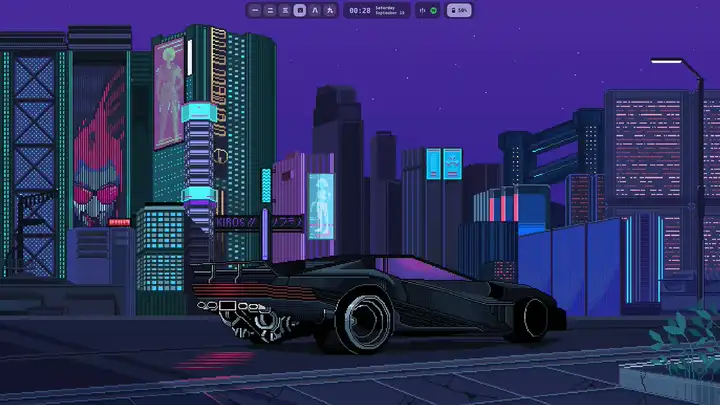
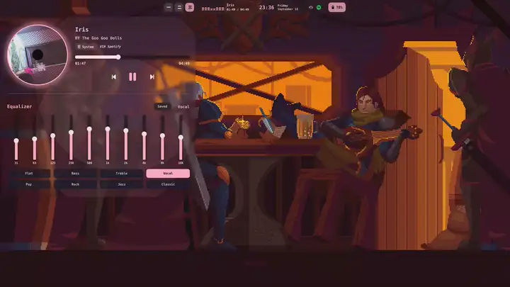
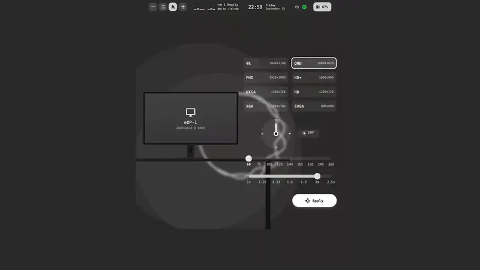
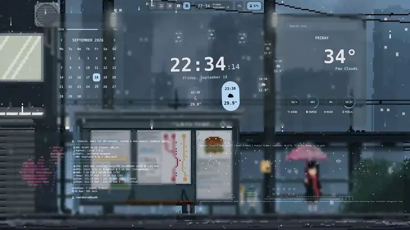
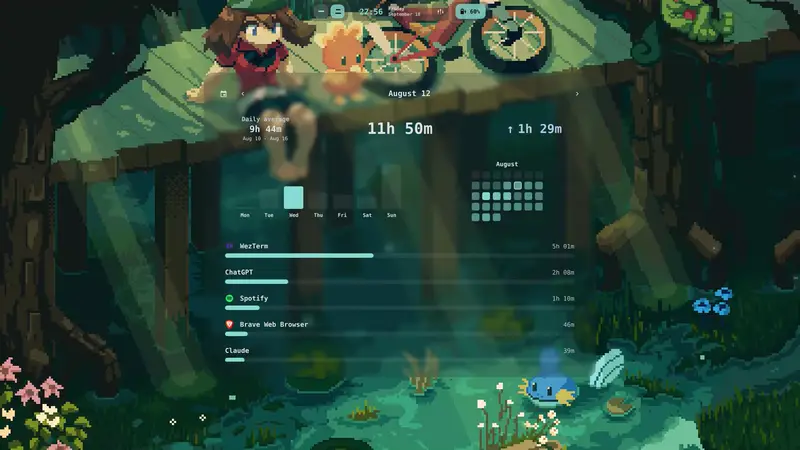
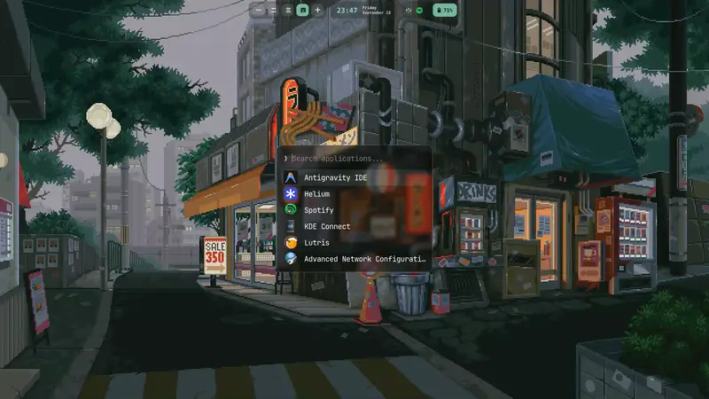
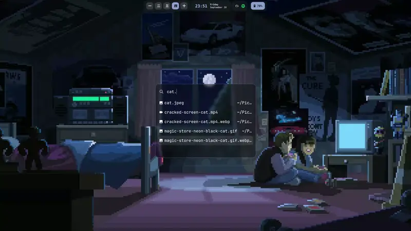

# ❄️ NixOS + Hyprland Desktop

<div align="center">

[](https://nixos.org)
[](https://hyprland.org)
[-8338EC?style=for-the-badge)](https://git.outfoxxed.me/outfoxxed/quickshell)
[](https://codeberg.org/explosion-mental/wallust)
[](https://wiki.nixos.org/wiki/Flakes)
[](LICENSE)

<p align="center">
  A fully declarative Wayland desktop environment built on NixOS, Hyprland, and custom QuickShell widgets. Portable to any machine from a single flake.
</p>

</div>

---

## Showcase

<div align="center">

### Desktop

<video src="https://github.com/user-attachments/assets/3ba514e8-7bc8-4353-bdab-dbad073716cc" controls autoplay muted width="900"></video>

<br/>

<sub>Wallpapers used in this setup are available in [Realdhiru/wallps](https://github.com/Realdhiru/wallps). Base desktop widgets were adapted from [ilyamiro/serpantinum](https://github.com/ilyamiro/serpantinum).</sub>
<br/>
<sub><b>Note:</b> The ~12 GB RAM shown in the video reflects a heavy workload (Kdenlive, Blender, Lutris, Brave tabs, Electron apps, coding agents). The desktop itself idles around <b>~2 GB</b> with compositor, blur, wallpaper, and QuickShell running.</sub>

</div>

### 🌟 QuickShell Desktop Widgets & Features

Custom event-driven QML widgets built natively on [QuickShell](https://git.outfoxxed.me/outfoxxed/quickshell) with zero polling overhead, Wayland IPC integration, and fluid micro-animations:

<table>
  <tr>
    <td width="50%" align="center">
      <b>Wallpaper Picker & Downloader</b><br/>
      <br/>
      <sub>3D parallax carousel with wallpaper browsing, favorites tracking (`SUPER + SHIFT + \`), online search & download, and instant switching.</sub>
    </td>
    <td width="50%" align="center">
      <b>Network Manager</b><br/>
      <br/>
      <sub>Radial interface for Wi-Fi, Ethernet, Bluetooth, and hotspot management.</sub>
    </td>
  </tr>
  <tr>
    <td width="50%" align="center">
      <b>Media Player & Equalizer</b><br/>
      <br/>
      <sub>Vinyl playback animation, MPRIS controls, and native 10-band PipeWire DSP equalizer.</sub>
    </td>
    <td width="50%" align="center">
      <b>Monitor Control</b><br/>
      <br/>
      <sub>Resolution, scaling, rotation, and refresh rate controls.</sub>
    </td>
  </tr>
  <tr>
    <td width="50%" align="center">
      <b>Calendar & Weather</b><br/>
      <br/>
      <sub>TopBar clock expansion with weather, forecast, calendar, and fastfetch.</sub>
    </td>
    <td width="50%" align="center">
      <b>Screen Time</b><br/>
      <br/>
      <sub>Per-app usage tracking, daily screen time charts, and focus timer.</sub>
    </td>
  </tr>
  <tr>
    <td width="50%" align="center">
      <b>Clipboard Manager</b><br/>
      <br/>
      <sub>Clipboard history with image previews, text snippets, and search.</sub>
    </td>
    <td width="50%" align="center">
      <b>App Launcher</b><br/>
      <br/>
      <sub>Fuzzel launcher with fuzzy matching and custom icon theme.</sub>
    </td>
  </tr>
  <tr>
    <td colspan="2" align="center">
      <b>Instant File Search</b><br/>
      <br/>
      <sub>Fuzzel-powered file search with directory navigation.</sub>
    </td>
  </tr>
</table>

---

## 🛠️ Software Stack

| Component | Software | Description |
| :--- | :--- | :--- |
| **OS & Package Manager** | [NixOS](https://nixos.org) (Unstable) + [Nix Flakes](https://wiki.nixos.org/wiki/Flakes) | Declarative, reproducible system with atomic generations |
| **Compositor / WM** | [Hyprland](https://hyprland.org) | Wayland dynamic tiling compositor configured in native Lua |
| **Desktop Shell & UI** | [QuickShell](https://git.outfoxxed.me/outfoxxed/quickshell) (Qt6 / QML) | Event-driven topbar, circular battery dial, MPRIS music & power popups |
| **Application Launcher** | [Fuzzel](https://codeberg.org/dnkl/fuzzel) | Wayland dmenu/rofi alternative with custom frosted glass styling |
| **Shell & Prompt** | [Zsh](https://www.zsh.org/) + [Starship](https://starship.rs/) | Fast, modular shell prompt with automated safety-gated `rebuild()` |
| **Theming** | [Wallust](https://codeberg.org/explosion-mental/wallust) | High-speed Rust wallpaper-derived color extraction across GTK, Qt, Foot, Alacritty, QuickShell, and Cava |
| **Icon Theme** | Buuf-Nestort | Hand-drawn skeuomorphic icon theme |
| **Typography** | JetBrains Mono Nerd Font | Monospace code font with comprehensive glyph and symbol support |
| **Lockscreen & Idle** | [Hyprlock](https://github.com/hyprwm/hyprlock) + [Hypridle](https://github.com/hyprwm/hypridle) | Instant GPU-accelerated Wayland lockscreen with dynamic screenshot blur & PAM authentication |
| **Wallpaper Daemons** | [awww](https://github.com/AvengeMedia/awww) + [mpvpaper](https://github.com/GhostNaN/mpvpaper) | High-performance static and live video wallpaper renderers |
| **Media Player** | [MPV](https://mpv.io) (with `mpvScripts.mpris`) | Hardware-accelerated player broadcasting D-Bus media tracking |
| **Music Streaming** | Spotify + [Spicetify](https://spicetify.app/) | Customized Spotify with Marketplace themes & extensions |
| **Screen Recording** | [GPU Screen Recorder](https://git.dec05eba.com/gpu-screen-recorder-gtk/) | Low-overhead NVENC/VAAPI screen capture |
| **Screenshots & Snips** | Grim + Slurp + Grimblast | Wayland screenshot suite with region selection & clipboard copy |
| **Audio Server & FX** | [PipeWire](https://pipewire.org) + WirePlumber (`filter-chain`) | Low-latency audio routing, native 10-band C DSP equalizer & mic processing |
| **Power Management** | [TLP](https://linrunner.de/tlp/) | Hardware power profiles, CPU scaling governor, EPP & battery charge thresholds (host-specific quirks isolated in `hosts/<host>/hardware/`) |
| **File Management** | [PCManFM-Qt](https://github.com/lxqt/pcmanfm-qt) + Filelight | Lightweight Qt file manager & interactive disk usage map |
| **Knowledge Base** | [Obsidian](https://obsidian.md) | Native Wayland markdown second-brain vault with interactive graph view |
| **Application Packaging** | [Nix Flakes](https://wiki.nixos.org/wiki/Flakes) + [AppImage](https://appimage.org/) | Custom standalone flakes, declarative packaging & kernel `binfmt_misc` AppImage execution |

---

## Installation & Deployment

Built for **100% portability** — fork it, edit one file, and deploy the entire desktop on any NixOS machine with zero hardcoded paths:
- Complete guide: [`docs/installation.md`](docs/installation.md)
- User identity is configured entirely in a single file: [`user.nix`](user.nix)

---

## Design & Technical Highlights

### Power & Thermal Management
- **Hardware-Level Power Authority**: TLP coordinates CPU energy-performance preferences (EPP), ASPM, and platform profiles across AC and battery, while enforcing battery charge thresholds directly at the firmware level. QuickShell event-driven automation automatically switches between AC performance and battery balanced profiles on plug/unplug events. Host-specific platform hooks and quirks are cleanly isolated under `hosts/<host>/hardware/` without polluting generic modules.
- **Dynamic GPU Shader Bypass**: On battery-saver profiles or solid black wallpapers, compositor dual-kawase blur shaders and drop shadows are automatically bypassed with 100% opaque window rendering, eliminating multi-pass GPU alpha-blending.
- **Event-Driven Telemetry (Zero Polling Loops)**: System telemetry reads directly from Linux kernel uevents and sysfs watchers rather than periodic shell polling timers. In-process `/proc` inspection in background daemons eliminates unnecessary subprocess forks, allowing CPU package states to settle into deep C-state sleep.
- **Transient Spike Control**: Disables aggressive dynamic frequency boost on battery to eliminate thermal spikes from background Chromium and Electron processes.

### Compositor & Desktop Workflow
- **Modular Lua Configuration**: Hyprland configuration is organized cleanly in native Lua modules (`hyprland.lua`), decoupling keybinds, rules, window animations, and environment variables.
- **Frame-0 Hot Reloading**: Synchronously evaluates cached power and visual states at startup and reload (`SUPER + R`), applying compositor rules in ~15ms without unmapping Wayland surfaces or cold-restarting desktop shell widgets.
- **Low-Latency Compositing Mode**: A dedicated keybind (`SUPER + SHIFT + G`) toggles Direct Scanout (`render:direct_scanout = 2`), Adaptive Sync (VRR), and asynchronous tearing for latency-sensitive full-screen workloads.
- **Pure Wayland Pipeline**: All Chromium and Electron apps run with native Wayland flags (`NIXOS_OZONE_WL = "1"`), providing kinetic touchpad gestures and subpixel scrolling.
- **Fuzzy File Navigation & Theming**: Centered interactive file search (`SUPER + SPACE`) with instant parent directory navigation in `pcmanfm-qt`, paired with in-place Wallust palette syncing across widgets, terminal, and launcher.
- **Emoji & Nerd Font Glyph Picker**: Unified fuzzy picker for emojis (3,773 Unicode 15.1 symbols) and Nerd Font v3 icons (10,386 glyphs) bound to `SUPER + .` via `fuzzel_menu.sh`, with instant `Tab` toggling between emoji and glyph databases, copying selected characters to clipboard with Wayland sub-millisecond selection ownership.

### Declarative System Infrastructure
- **Safety-Gated Rebuild Workflow**: A custom rebuild pipeline validates builds before activation, runs a post-switch health gate with automated rollbacks, and retains a 14-day garbage collection safety window while tracking floating `nixos-unstable`.
- **Integrated System Packaging**: Declarative custom derivations, custom standalone Flakes for third-party applications, native AppImage execution via Linux kernel `binfmt_misc`, and declarative Flathub integration without background container daemons.
- **Clean Display Authentication**: Lightweight TTY display manager (`ly`) with PAM authentication, cleanly decoupling graphical login from session startup.

---

## Architecture & System Structure

```text
nix/
├── flake.nix                          # Flake entrypoint, nixpkgs-unstable & community inputs
├── flake.lock                         # Deterministic input lockfile
├── home.nix                           # Home Manager root configuration
├── pkgs/                              # Custom Nix package derivations & patches
│   ├── buuf-nestort.nix
│   ├── gameclean/                     # Wine/Proton leftover janitor (Python source)
│   ├── gameclean.nix                  # gameclean derivation
│   ├── hypr-kdeconnect-portal.nix
│   └── pcmanfm-qt-appid.patch
├── hosts/
│   └── nixos/
│       ├── default.nix                # Host-level imports, disk UUIDs & swap configuration
│       ├── hardware-configuration.nix # Kernel modules, filesystems, and hardware drivers
│       └── hardware/                  # Machine-specific hardware quirks
│           └── asus.nix               # Host-specific ASUS ROG/Vivobook hardware quirks
├── modules/
│   ├── system/                        # Portable declarative NixOS system services
│   │   ├── boot.nix                   # systemd-boot EFI, kernel tuning & ZRAM
│   │   ├── fonts.nix                  # CJK, monospace, and Nerd Font typography
│   │   ├── gaming.nix                 # Low-latency gaming kernel & graphics stack
│   │   ├── packages.nix               # System-wide CLI & GUI package manifests
│   │   ├── power.nix                  # TLP power management & battery charge thresholds
│   │   ├── services.nix               # NetworkManager, PipeWire, udev, & D-Bus daemons
│   │   └── users.nix                  # User account privileges & sudo rules
│   └── home/                          # User-space Home Manager modules
│       ├── shell.nix                  # Zsh environment, custom rebuild() gate & aliases
│       ├── spicetify.nix              # Declarative Spotify theming
│       └── theme.nix                  # GTK, icon, and cursor theming
├── dotfiles/                          # Symlinked user configuration tree
│   ├── alacritty/                     # Hardware-accelerated GPU terminal
│   ├── fastfetch.jsonc                # System info presenter
│   ├── starship.toml                  # Minimal shell prompt
│   ├── fuzzel/
│   │   └── fuzzel.ini                 # 2x HiDPI centered application & file launcher
│   ├── wallust/                       # Dynamic color extraction config & templates
│   └── hypr/                          # Hyprland Wayland compositor configuration (Lua)
│       ├── hyprland.lua               # Compositor core entrypoint
│       ├── appearance.lua             # Dual-kawase blur, shadows, and smooth Bezier curves
│       ├── keybinds.lua               # Window management, workspace & utility keybindings
│       ├── rules.lua                  # Window rules & Frame-0 opacity evaluation
│       ├── scripts/                   # Performance toggles & helper utilities
│       └── scripts/quickshell/        # Curated QuickShell QML widget suite
│           ├── Shell.qml              # Wayland layer-shell root entrypoint
│           ├── TopBar.qml             # Status bar (Kanji workspaces, clock, tray, battery)
│           ├── SysData.qml            # Hardware telemetry & live profile listener
│           ├── battery/               # Control center popup (power, brightness, audio, actions)
│           ├── network/               # Wi-Fi network panel & hotspot controller
│           ├── music/                 # MPRIS media player drawer
│           └── watchers/              # Event-driven udev and PipeWire stream watchers
└── docs/
    ├── decisions.md                   # Permanent architectural invariants & rationale
    ├── debugging.md                   # Historical issues, root causes & verified fixes
    ├── flow.md                        # Boot, startup sequencing & emergency recovery
    ├── installation.md                # Fresh machine setup & deployment guide
    ├── quickshell-settings.md         # settings.json controls and valid values
    └── assets/                        # High-resolution showcase media
```

---

## Setup & Reproduction

### 1. Prerequisites (Fresh Machine)
Ensure NixOS is installed and Flakes are enabled in `/etc/nixos/configuration.nix`:
```nix
nix.settings.experimental-features = [ "nix-command" "flakes" ];
```

### 2. Clone & Adapt Hardware
```bash
git clone https://github.com/Realdhiru/nix.git ~/nix
cd ~/nix

# Generate hardware configuration for the target machine
nixos-generate-config --show-hardware-config > hosts/nixos/hardware-configuration.nix
```

### 3. Initial Build & Activation
```bash
# Build and activate the configuration
sudo nixos-rebuild switch --flake .#nixos
```

### 4. Custom Management Commands

The shell environment (`modules/home/shell.nix`) provides a dedicated suite of workflow functions to manage, inspect, and maintain the system safely:

#### `rebuild [commit message]`
The primary command for applying configuration changes. It implements an automated health-gated safety pipeline:
1. Records the previous known-good system generation and git revision to `~/.cache/nix_rebuild_log`.
2. Creates an atomic `known-good` git tag and automatically stages/commits all modified files.
3. Executes `sudo nixos-rebuild build --flake .#nixos`. If compilation fails, execution aborts immediately without activating anything.
4. Switches to the new generation and executes `scripts/health-check.sh` (validating Hyprland session integrity and GPU-hang probes).
5. If a critical failure is detected, it **automatically rolls back** to the previous generation, preserves the failed generation in the bootloader for debugging, and generates a diagnostic log.

```bash
# Example: Apply changes with an automated commit & health check
rebuild "feat: adjust hyprland window rules"
```

#### `update`
Pulls the latest git changes, updates flake inputs to the latest `nixos-unstable` revision, and executes a verified rebuild:
```bash
update
```

#### `gens`
Displays an annotated, color-coded list of all system generations present in `/nix/var/nix/profiles/`, highlighting the currently `[ACTIVE]` generation and any `[PINNED STABLE]` generations:
```bash
gens
```

#### `pin-stable [generation_number]`
Pins a specific generation (or the currently active generation if no argument is passed) as a permanent GC root (`/nix/var/nix/gcroots/boot-stable`). Pinned generations are permanently protected from garbage collection:
```bash
# Pin current generation
pin-stable

# Pin specific generation (e.g. generation 835)
pin-stable 835
```

#### `clean`
Safely purges unpinned Nix store paths older than 14 days (`--delete-older-than 14d`), ensuring that rollback targets and recent known-good generations remain fully bootable:
```bash
clean
```

#### `gameclean [ -y -q ]`
Wine/Proton/Lutris storage janitor (see [`docs/gameclean.md`](docs/gameclean.md)). Wine games scatter files across five locations (game dir, Wine prefixes, umu/Proton prefix, `~/.cache` caches, Lutris entries), so uninstalling the game folder alone leaves tens of GB of orphaned junk. `gameclean` scans Lutris entries + prefixes + caches in one pass:
```bash
gameclean        # preview what would be deleted (default, safe)
gameclean -y     # actually delete the flagged leftovers
```

#### `ff` & `af`
- **`ff`**: Quick alias for `fastfetch`.
- **`af`**: Interactive animated terminal fetcher that cycles through GIFs/MP4s in `~/Pictures/fastfetch` using `anifetch`, dynamically calculating terminal cell aspect ratios (`ffprobe`) to prevent image distortion.

---

## Technical Documentation

Deep-dive architecture and deployment guides are documented in [`docs/`](docs/):

* **[Installation Guide](docs/installation.md)** — Step-by-step setup on a fresh machine.
* **[Architecture Decisions (ADR)](docs/decisions.md)** — Core design principles, TLP authority, and system non-negotiables.
* **[Debugging & Troubleshooting](docs/debugging.md)** — Complete historical catalog of solved hardware and desktop quirks.
* **[Execution Flows](docs/flow.md)** — Boot pipeline, startup sequencing, and emergency recovery paths.
* **[QuickShell Settings](docs/quickshell-settings.md)** — Runtime settings keys, choices, and current defaults.
* **[Game Storage Janitor](docs/gameclean.md)** — Wine/Proton/Lutris leftover scanner & cleaner usage, coverage & safety model.
