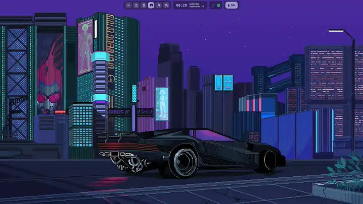
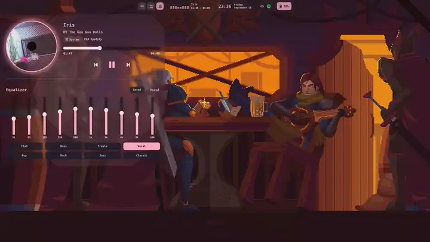
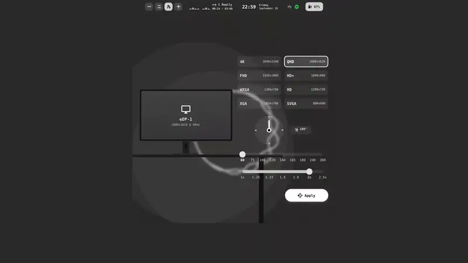
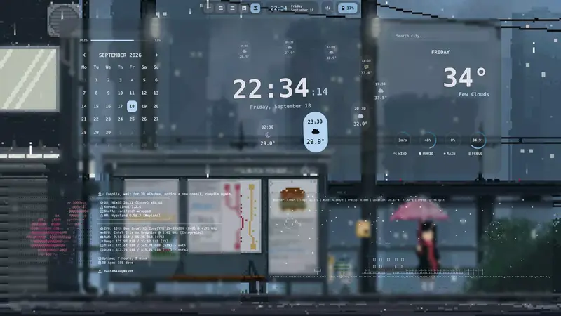
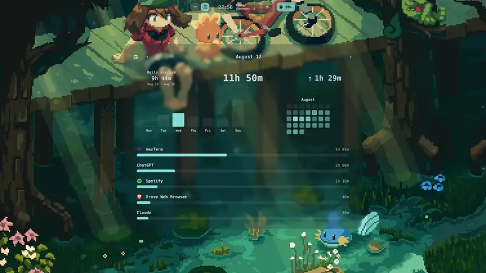
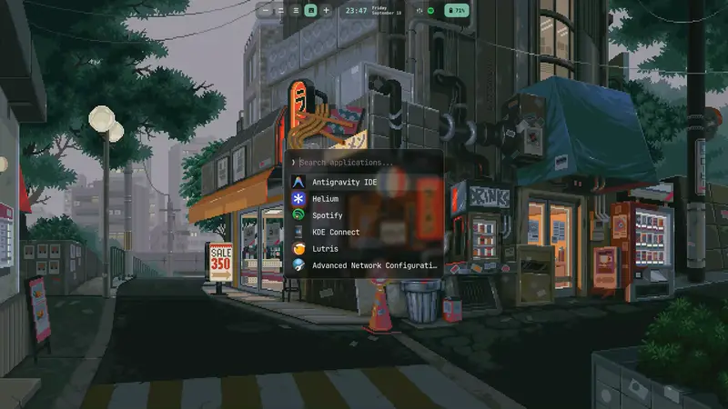
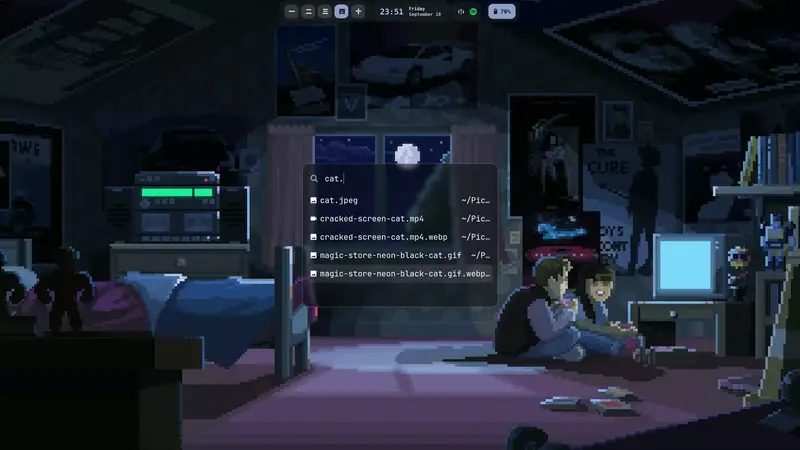

# ❄️ NixOS + Hyprland Desktop

<div align="center">

[](https://nixos.org)
[](https://hyprland.org)
[-8338EC?style=for-the-badge)](https://git.outfoxxed.me/outfoxxed/quickshell)
[](https://codeberg.org/explosion-mental/wallust)
[](https://wiki.nixos.org/wiki/Flakes)
[](LICENSE)

<p align="center">
  A declarative Wayland desktop for NixOS, Hyprland, and custom QuickShell widgets. Hardware facts are isolated per host; the current flake targets x86_64-linux.
</p>

</div>

---

## 🌟 QuickShell Desktop Widgets & Features

Custom QML widgets built natively on [QuickShell](https://git.outfoxxed.me/outfoxxed/quickshell), driven by Wayland events with bounded sampling for live statistics:

<table>
  <tr>
    <td width="50%" align="center">
      <b>Wallpaper Picker & Downloader</b><br/>
      <br/>
      <sub>3D parallax carousel with wallpaper browsing, favorites tracking (`\`), online search & download, and instant switching.</sub>
    </td>
    <td width="50%" align="center">
      <b>Network Manager</b><br/>
      <br/>
      <sub>Radial interface for Wi-Fi, Ethernet, Bluetooth, and hotspot management.</sub>
    </td>
  </tr>
  <tr>
    <td width="50%" align="center">
      <b>Media Player & Equalizer</b><br/>
      <br/>
      <sub>Vinyl playback animation, MPRIS controls, and native 10-band PipeWire DSP equalizer.</sub>
    </td>
    <td width="50%" align="center">
      <b>Monitor Control</b><br/>
      <br/>
      <sub>Resolution, scaling, rotation, and refresh rate controls.</sub>
    </td>
  </tr>
  <tr>
    <td width="50%" align="center">
      <b>Calendar & Weather</b><br/>
      <br/>
      <sub>TopBar clock expansion with weather, forecast, calendar, and fastfetch.</sub>
    </td>
    <td width="50%" align="center">
      <b>Screen Time</b><br/>
      <br/>
      <sub>Per-app usage tracking, daily screen time charts, and focus timer.</sub>
    </td>
  </tr>
  <tr>
    <td width="50%" align="center">
      <b>Clipboard Manager</b><br/>
      <br/>
      <sub>Clipboard history with image previews, text snippets, and search.</sub>
    </td>
    <td width="50%" align="center">
      <b>App Launcher</b><br/>
      <br/>
      <sub>Fuzzel launcher with fuzzy matching and custom icon theme.</sub>
    </td>
  </tr>
  <tr>
    <td colspan="2" align="center">
      <b>Instant File Search</b><br/>
      <br/>
      <sub>Fuzzel-powered file search with directory navigation.</sub>
    </td>
  </tr>
</table>

<sub>Wallpapers available in [Realdhiru/wallps](https://github.com/Realdhiru/wallps). Base widgets adapted from [ilyamiro/serpantinum](https://github.com/ilyamiro/serpantinum). System idles at <b>~2 GB RAM</b> with compositor, blur shaders, wallpaper engine, and QuickShell running.</sub>

---

## 🛠️ Software Stack

| Component | Software | Description |
| :--- | :--- | :--- |
| **OS & Packages** | [NixOS](https://nixos.org) (Unstable) + [Flakes](https://wiki.nixos.org/wiki/Flakes) | Atomic, fully declarative system configuration with automated rollback gates |
| **Compositor** | [Hyprland](https://hyprland.org) | Wayland dynamic compositor with continuous scrolling ribbon (`scrolling.lua`) & Dwindle mode parity (`SUPER + F10`) |
| **Desktop Shell** | [QuickShell](https://git.outfoxxed.me/outfoxxed/quickshell) (Qt6 / QML) | Event-driven UI with exclusive focus grab (`WlrKeyboardFocus`); FocusTime and battery audit use bounded sampling |
| **Theming** | [Wallust](https://codeberg.org/explosion-mental/wallust) | Sub-millisecond wallpaper-derived color extraction across UI, terminals & GTK |
| **Audio Engine** | [PipeWire](https://pipewire.org) (`filter-chain`) | Low-latency audio routing with 10-band C DSP equalizer, spectral vocal subtraction LADSPA plugin, & smart volume ceilings |
| **Power Engine** | [TLP 1.10.2](https://linrunner.de/tlp/) | Firmware battery threshold (80%), TLP-owned profiles, deep C-states, & 802.11 Wi-Fi power-save |
| **Launchers** | [Fuzzel](https://codeberg.org/dnkl/fuzzel) | Frosted glass app launcher, instant file search & emoji/glyph picker |
| **Knowledge Base** | [Obsidian](https://obsidian.md) | Native Wayland markdown second-brain vault with interactive graph view |

---

## ⌨️ Desktop Keybindings

Standardized keybind conventions organized into distinct functional tiers:

| Tier | Keybinding | Action |
| :--- | :--- | :--- |
| **Daily Core** | `SUPER + A` / `SUPER + SPACE` | App Launcher / Instant File Search |
| | `SUPER + T` / `SUPER + B` / `SUPER + E` / `SUPER + C` | Terminal (Alacritty) / Browser / File Manager / Editor |
| | `SUPER + Q` | Close focused window gracefully (`Actions::closeWindow`) |
| | `SUPER + F10` | Toggle dual layout (Dwindle $\leftrightarrow$ Continuous Scrolling Ribbon) |
| **Daily Widgets** | `SUPER + N` / `SUPER + U` / `SUPER + V` / `SUPER + M` / `SUPER + F` | Toggle Network / Battery / Clipboard / Music / Focus Timer |
| | `SUPER + L` | Toggle Light / Dark quickshell theme mode |
| **Secondary Widgets** | `SUPER + SHIFT + W` / `SUPER + SHIFT + N` / `SUPER + SHIFT + M` / `SUPER + SHIFT + A` | Toggle Wallpaper Picker / Calendar / Display Manager / Sunset Tint |
| | `SUPER + SHIFT + X` | Fast offline OCR region capture to clipboard |
| | `\` (in Wallpaper Picker) | Toggle favorite wallpaper |
| **Web Applications** | `SUPER + ALT + W` / `Y` / `C` / `A` / `N` / `D` / `G` | Launch WhatsApp / YouTube / ChatGPT / Claude / Notion / To-Do / Antigravity |
| **Hardware & System** | `SUPER + F6` | Toggle Multi-Sink Audio Broadcast |
| | `SUPER + F7` | Recover PipeWire Audio Subsystem |
| | `SUPER + F8` | Toggle QuickShell Desktop Shell |
| | `SUPER + R` | Reload Compositor, QuickShell, and Theme |

---

## 🚀 Installation & Setup

Install on a fresh NixOS system:

1. **Clone the repository**:
   ```bash
   git clone https://github.com/Realdhiru/nix.git ~/nix
   cd ~/nix
   ```
2. **Generate your hardware configuration**:
   ```bash
   nixos-generate-config --show-hardware-config > hosts/nixos/hardware-configuration.nix
   ```
   *(Optional)* Edit [`user.nix`](user.nix) to set your username and default applications.
3. **Build and switch**:
   ```bash
   sudo nixos-rebuild switch --flake .#nixos
   ```

---

### 📁 Where Data & Customizations Live

- **User Preferences**: [`user.nix`](user.nix) is the single file for username, default terminal, browser, and apps.
- **Hardware Profile**: [`hosts/nixos/hardware-configuration.nix`](hosts/nixos/hardware-configuration.nix) contains machine-specific kernel modules and drive UUIDs.
- **Wallpapers**: Stored in `~/Pictures/Wallpapers/` (default fallback in `dotfiles/wallpaper/default.jpg`).
- **Runtime State**: Desktop state (wallpapers, modes, screen time) lives in `~/.local/state/desktop/` and persists across rebuilds.

---

## 🧭 System Commands

| Command | Description |
| :--- | :--- |
| `rebuild` | Builds, verifies, and switches system generation with auto-rollback |
| `update` | Updates flake inputs (`nixos-unstable`) and rebuilds |
| `clean` | Safely removes unpinned system store paths older than 14 days |
| `gens` | Lists system boot generations with active markers |
| `pin-stable` | Pins the current generation so garbage collection never deletes it |
| `af` / `ff` | Terminal fetchers (`anifetch` / `fastfetch`) |

---

## 📚 System Documentation

Architecture, hardware notes, and recovery specs documented in [`docs/`](docs/):

| Area | Focus | Key Topics |
| :--- | :--- | :--- |
| 🏛️ **Architecture** | [Flake & System](docs/02%20-%20Flake%20&%20System%20Architecture/) · [Nix Philosophy](docs/01%20-%20The%20Why%20&%20Nix%20Philosophy/) | Flake topology, modular structure, declarative ownership |
| 🖥️ **Compositor & UI** | [Hyprland Engine](docs/03%20-%20Compositor%20&%20Hyprland%20Engine/) · [QuickShell](docs/04%20-%20QuickShell%20QML%20Desktop/) · [Wallust](docs/05%20-%20Theming%20&%20Wallust%20Engine/) | Dual layout switcher, Qt6/QML widgets, semantic color palette |
| ⚡ **Hardware & Power** | [Power Authority](docs/06%20-%20Power%20&%20Hardware%20Authority/) · [Audio Pipeline](docs/07%20-%20Audio%20&%20Media%20Pipeline/) | TLP power policy, PipeWire 10-band DSP equalizer, LADSPA plugins |
| 🛡️ **Recovery & ADR** | [Recovery Procedures](docs/08%20-%20Operational%20Flow%20&%20Recovery/) · [Decisions](docs/decisions.md) · [Tacit Knowledge](docs/tacit_knowledge.md) | Emergency rollbacks, architecture decision records, hardware quirks |
